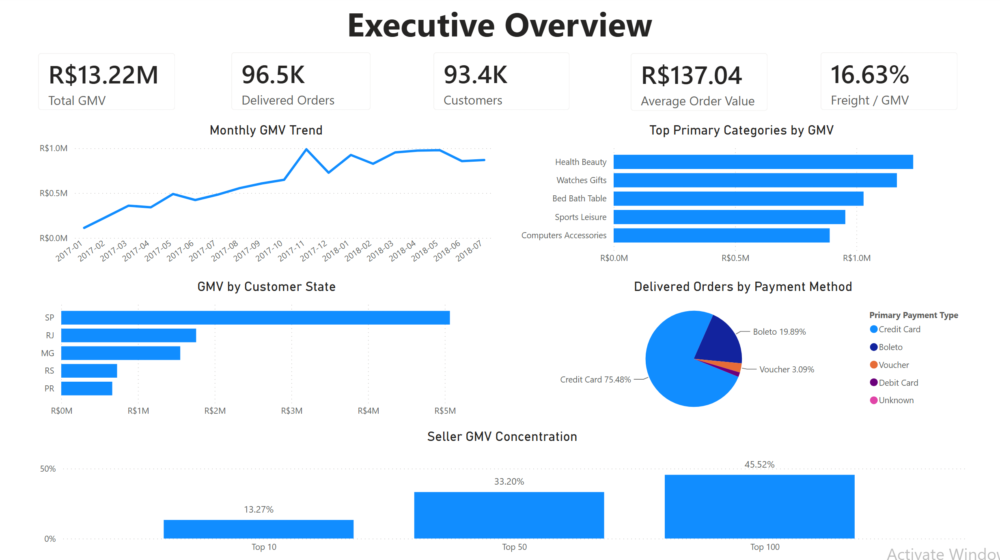
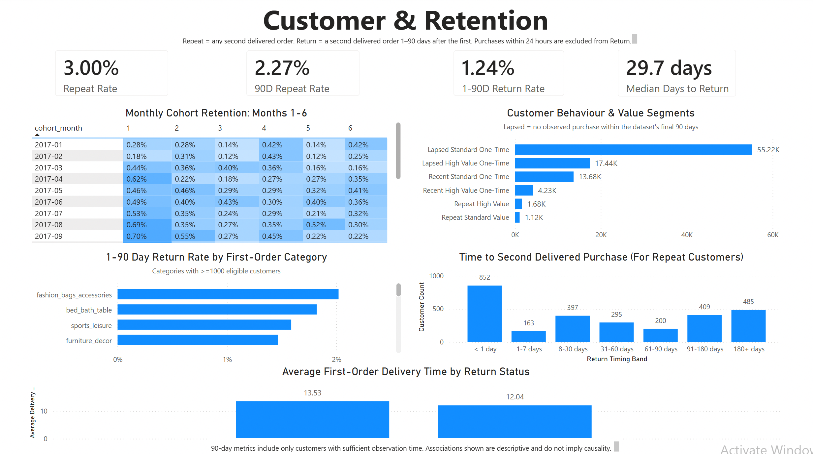
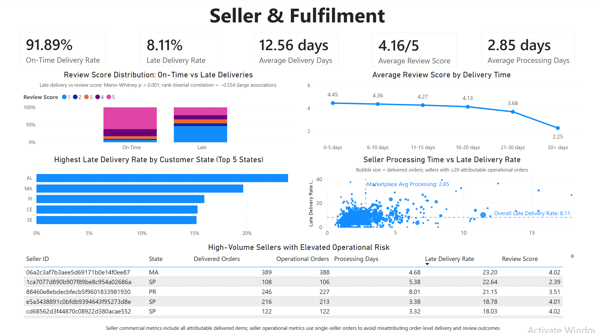

# Olist Commercial & Customer Analytics

An end-to-end e-commerce analytics project using **PostgreSQL, Python, Power BI and DAX** to analyse commercial performance, customer retention, seller performance and fulfilment experience across approximately 100,000 marketplace orders.

The project transforms the public Olist Brazilian e-commerce dataset from raw relational CSVs into validated analytical marts, statistically tests key business relationships, and presents the results through an interactive three-page Power BI dashboard.

---

## Executive Summary

The marketplace generated **R$13.22M in delivered GMV** across **96,478 delivered orders** from **93,358 customers**.

Customer repeat purchasing was limited:

- **3.00%** of customers made more than one delivered purchase;
- **2.27%** of customers with sufficient observation time repeated within 90 days;
- only **1.24%** made a distinct return purchase between 1 and 90 days after their first order when purchases within the first 24 hours were excluded.

Fulfilment showed the clearest relationship with customer experience. Late deliveries had substantially worse review outcomes than on-time deliveries, with a **rank-biserial effect size of -0.554**.

However, fulfilment variables showed only weak relationships with subsequent customer return behaviour.

The analysis therefore suggests that:

> **Fulfilment improvement should primarily be treated as a customer-experience priority, while retention should be approached as a separate problem requiring targeted experimentation and richer behavioural data.**

---

# Dashboard

## 1. Executive Commercial Overview



Tracks:

- delivered GMV;
- order volume;
- customer volume;
- average order value;
- freight burden;
- monthly commercial performance;
- product-category mix;
- customer geography;
- payment behaviour;
- seller GMV concentration.

---

## 2. Customer & Retention



Analyses:

- overall repeat purchasing;
- 30/60/90-day repeat behaviour;
- strict 1–90 day customer return;
- cohort retention;
- customer value and behaviour segments;
- time to second purchase;
- first-order category differences;
- first-order fulfilment characteristics.

---

## 3. Seller & Fulfilment



Analyses:

- on-time and late-delivery performance;
- delivery duration;
- seller processing time;
- review-score distributions;
- geographic fulfilment differences;
- seller operational performance;
- high-volume sellers with elevated fulfilment risk.

---

# Business Problem

The project addresses the question:

> **How can an e-commerce marketplace improve commercial performance and customer retention by understanding customer behaviour, product/category performance, seller performance and fulfilment experience?**

The analysis is organised around three pillars:

### Commercial Performance

Understand where marketplace value comes from across:

- time;
- categories;
- geography;
- payment methods;
- sellers.

### Customer & Retention

Understand:

- how frequently customers return;
- how long customers take to make a second purchase;
- how retention differs across cohorts and categories;
- whether first-order characteristics are associated with subsequent purchasing.

### Seller & Fulfilment

Understand:

- where delivery problems occur;
- which sellers show elevated operational risk;
- how delivery performance relates to customer satisfaction.

---

# Technology

| Layer                   | Technology                                   |
| ----------------------- | -------------------------------------------- |
| Database                | PostgreSQL                                   |
| Data transformation     | SQL                                          |
| Statistical analysis    | Python                                       |
| Python libraries        | Pandas, NumPy, SciPy, SQLAlchemy, Matplotlib |
| Visualisation           | Power BI                                     |
| BI calculations         | DAX                                          |
| Reproducibility         | Bash                                         |
| Development environment | Jupyter Notebook                             |

---

# Architecture

```text
Olist source CSVs
        │
        ▼
PostgreSQL raw schema
        │
        ▼
Data-quality audit
        │
        ▼
Clean staging tables
        │
        ▼
Validated analytical marts
        │
        ├───────────────┐
        ▼               ▼
SQL business       Python statistical
analysis           validation
        │               │
        └───────┬───────┘
                ▼
       BI-facing SQL views
                │
                ▼
      Reproducible CSV exports
                │
                ▼
          Power BI + DAX
                │
                ▼
     Dashboard & recommendations
```

Core analytical logic remains in PostgreSQL.

Power BI receives reproducible extracts generated from validated BI-facing database views rather than containing duplicated transformation logic.

---

# Data Model

The project uses five principal analytical datasets.

## `analytics.order_mart`

**Grain: one row per order**

Contains:

- customer identity;
- GMV;
- freight;
- item counts;
- product-category information;
- payment information;
- reviews;
- delivery metrics.

One-to-many tables are aggregated before joining to prevent row multiplication.

---

## `analytics.customer_mart`

**Grain: one row per customer**

Contains:

- first, second and last purchase;
- delivered-order frequency;
- customer GMV;
- time to second purchase;
- first-order characteristics;
- 30/60/90-day observation eligibility;
- fixed-horizon repeat indicators.

Customer analysis uses `customer_unique_id` rather than order-level `customer_id`.

---

## `analytics.cohort_retention`

**Grain: cohort month × month since first purchase**

Supports cohort-retention analysis while preserving original cohort sizes and active-customer counts.

---

## `analytics.customer_segments`

**Grain: one row per customer**

Segments customers by:

- repeat vs one-time behaviour;
- recent vs lapsed observation;
- high vs standard customer value.

Classic RFM scoring was deliberately avoided because approximately 97% of customers had only one delivered order.

---

## `analytics.seller_mart`

**Grain: one row per seller**

Contains:

- seller order volume;
- customers served;
- GMV;
- processing performance;
- late-delivery performance;
- review outcomes.

Commercial metrics use all seller-attributable items.

Operational seller metrics use **single-seller orders only** to avoid assigning shared order-level delivery or review outcomes to multiple sellers.

---

# Data Quality & Validation

The raw source was audited before transformation for:

- table row counts;
- key uniqueness;
- duplicate keys;
- referential integrity;
- order-status distribution;
- null timestamps;
- invalid timestamp sequences;
- numeric validity;
- customer identity;
- review multiplicity;
- multi-item and multi-payment orders;
- source date coverage.

Validation was repeated after:

- staging;
- order-mart construction;
- customer-mart construction;
- cohort construction;
- customer segmentation;
- seller-mart construction.

Key reconciliations include:

```text
Delivered order GMV
=
Seller-attributed delivered GMV
=
R$13,221,498.11
```

and:

```text
Delivered customer count
=
Customer mart count
=
93,358
```

---

# Customer Retention Methodology

## Repeat Customer

A customer with at least two delivered orders.

Observed rate:

**3.00%**

---

## Fixed-Horizon Repeat Rates

Customers entering the dataset near the observation end have less opportunity to return.

To reduce right-censoring, the project creates eligibility indicators for:

- 30-day follow-up;
- 60-day follow-up;
- 90-day follow-up.

Observed repeat rates:

| Horizon | Eligible Customers | Repeaters | Repeat Rate |
| ------- | -----------------: | --------: | ----------: |
| 30 days |             86,909 |     1,377 |       1.58% |
| 60 days |             81,265 |     1,585 |       1.95% |
| 90 days |             75,387 |     1,715 |       2.27% |

---

## Strict 1–90 Day Return

Analysis showed that **852 of 2,801 repeat customers — 30.4% — placed their second order within 24 hours**.

These may represent:

- split orders;
- forgotten items;
- continuation of the same shopping session.

The project therefore also defines a stricter return metric:

```text
Second delivered purchase >= 1 day after first purchase
AND
Second delivered purchase <= 90 days after first purchase
```

Among 75,387 eligible customers:

**932 returned within 1–90 days → 1.24%**

This distinction prevents transactional repetition from being automatically interpreted as customer retention.

---

# Statistical Validation

Python is used to validate selected descriptive findings rather than build a predictive model.

Effect sizes are reported alongside p-values because large datasets can make commercially trivial differences statistically significant.

## Late Delivery vs Review Score

Method:

- Mann–Whitney U test;
- rank-biserial correlation.

Result:

```text
p < 0.001
rank-biserial ≈ -0.554
```

Approximately:

- **46.2% of late deliveries received 1 star**
- **6.6% of on-time deliveries received 1 star**

This represents a large negative association between late delivery and customer satisfaction.

---

## Delivery Duration vs Review Score

Method:

- Spearman rank correlation.

Result:

```text
rho ≈ -0.235
p < 0.001
```

Average reviews declined from approximately:

| Delivery Time | Avg Review |
| ------------- | ---------: |
| 0–5 days      |       4.45 |
| 6–10 days     |       4.36 |
| 11–15 days    |       4.27 |
| 16–20 days    |       4.13 |
| 21–30 days    |       3.68 |
| 30+ days      |       2.25 |

Very long delivery durations were associated with particularly poor review outcomes.

---

## First-Order Experience vs Customer Return

First-order characteristics were compared between:

- customers returning within 1–90 days;
- eligible customers who did not return within 1–90 days.

Observed differences in:

- delivery duration;
- review score;
- item count

were statistically detectable but small in practical magnitude.

Late first delivery versus return behaviour produced approximately:

```text
Cramér's V ≈ 0.007
```

indicating negligible practical association.

---

## Payment Method vs Return

```text
p ≈ 0.648
Cramér's V ≈ 0.005
```

No meaningful relationship was observed.

---

## Product Category vs Return

```text
p < 0.001
Cramér's V ≈ 0.035
```

Category differences were detectable but weak overall.

---

# Key Findings

### 1. Commercial growth was primarily volume-driven

Marketplace GMV and order volumes increased substantially during the main 2017–2018 analysis period, while average order value remained comparatively stable.

---

### 2. Commercial activity is geographically concentrated

São Paulo contributed approximately **38% of marketplace GMV**, while São Paulo, Rio de Janeiro and Minas Gerais together accounted for roughly **63%**.

---

### 3. Seller activity follows a long tail

The marketplace contained approximately 2,970 active sellers.

The top:

- 10 sellers generated approximately **13.3% of GMV**;
- 50 generated **33.2%**;
- 100 generated **45.5%**.

---

### 4. Genuine customer return is rare

Observed customer metrics were:

```text
Ever repeat         3.00%
90-day repeat       2.27%
Strict 1–90 return  1.24%
```

This highlights the importance of distinguishing transaction repetition from genuine customer return behaviour.

---

### 5. Payment method provides little retention signal

Differences in customer return rates across major payment methods were small and statistically insignificant.

---

### 6. Product category contains some retention variation

Return behaviour differs across categories, although the overall statistical relationship remains weak.

This suggests category-specific experimentation may be more useful than one marketplace-wide retention strategy.

---

### 7. Fulfilment strongly affects satisfaction

Late deliveries were associated with substantially worse customer reviews.

The relationship between late delivery and satisfaction was considerably stronger than the relationship between late delivery and customer return.

---

### 8. Satisfaction and retention should be treated separately

The strongest overall analytical conclusion is:

> **Fulfilment performance is strongly associated with immediate customer satisfaction, but only weakly associated with subsequent purchasing behaviour.**

Improving fulfilment therefore has strong customer-experience justification, but the evidence does not support assuming that it will materially solve low customer retention.

---

# Recommendations

## 1. Prioritise high-volume fulfilment outliers

Focus operational investigation on sellers and fulfilment segments that combine:

- meaningful transaction volume;
- above-market processing time;
- elevated late-delivery rates.

This targets operational intervention where the greatest number of customers are affected.

---

## 2. Monitor severe delays separately from average delivery time

Orders exceeding 20–30 days show sharply worse review outcomes.

Operational reporting should monitor:

- orders exceeding 20 days;
- orders exceeding 30 days;
- severe-delay rates by seller;
- severe-delay rates by geography.

---

## 3. Separate customer-experience KPIs from retention KPIs

Fulfilment initiatives should be evaluated using:

- late-delivery rate;
- severe-delay rate;
- customer reviews.

Retention initiatives should separately monitor:

- 30-day repeat rate;
- 60-day repeat rate;
- 90-day repeat rate;
- strict 1–90 day return rate.

This prevents improvement in one objective from being incorrectly assumed to improve the other.

---

## 4. Test category-specific retention strategies

Payment method provides little retention signal, while product category shows greater—although still weak—variation.

Potential experiments could include:

- category-specific cross-sell;
- post-purchase product recommendations;
- replenishment reminders;
- targeted repeat-purchase incentives.

These should be experimentally tested rather than assumed to cause higher retention.

---

## 5. Report return behaviour separately from repeat transactions

Retention reporting should distinguish between:

```text
customer purchased twice
```

and:

```text
customer genuinely returned after the initial purchase
```

This prevents same-session or split transactions from overstating customer retention.

---

# Repository Structure

```text
.
├── README.md
├── requirements.txt
│
├── data/
│   └── README.md
│
├── sql/
│   ├── 01_create_raw_schema.sql
│   ├── 02_import_raw_data.sql
│   ├── 03_data_quality_audit.sql
│   ├── 04_clean_customers.sql
│   ├── 05_clean_products.sql
│   ├── 06_clean_sellers.sql
│   ├── 07_clean_orders.sql
│   ├── 08_clean_order_items.sql
│   ├── 09_clean_payments.sql
│   ├── 10_clean_reviews.sql
│   ├── 11_validate_staging.sql
│   ├── 12_create_order_mart.sql
│   ├── 13_validate_order_mart.sql
│   ├── 14_create_customer_mart.sql
│   ├── 15_validate_customer_mart.sql
│   ├── 16_create_cohort_mart.sql
│   ├── 17_validate_cohort_mart.sql
│   ├── 18_create_customer_segments.sql
│   ├── 19_validate_customer_segments.sql
│   ├── 20_create_seller_mart.sql
│   ├── 21_validate_seller_mart.sql
│   ├── 22_commercial_analysis.sql
│   ├── 23_customer_retention_analysis.sql
│   ├── 24_seller_fulfilment_analysis.sql
│   └── 26_create_powerbi_views.sql
│
├── python/
│   └── 25_statistical_validation.ipynb
│
├── scripts/
│   └── export_powerbi_data.sh
│
├── powerbi/
│   └── olist_commercial_customer_analytics.pbix
│
├── docs/
│   ├── data_dictionary.md
│   ├── methodology.md
│   └── findings_and_recommendations.md
│
└── images/
    ├── executive_overview.png
    ├── customer_retention.png
    └── seller_fulfilment.png
```

Raw source data and generated Power BI CSV extracts are intentionally excluded from version control.

---

# Reproducing the Project

## 1. Clone the repository

```bash
git clone <repository-url>
cd olist-commercial-customer-analytics
```

---

## 2. Obtain the Olist dataset

Download the Brazilian E-Commerce Public Dataset by Olist and place the nine required CSVs inside:

```text
data/raw/
```

See:

```text
data/README.md
```

for the expected files.

---

## 3. Create the PostgreSQL database

```bash
createdb olist_analytics
```

---

## 4. Build and validate the SQL pipeline

Run the SQL scripts in numerical order.

For example:

```bash
psql -d olist_analytics -f sql/01_create_raw_schema.sql
psql -d olist_analytics -f sql/02_import_raw_data.sql
psql -d olist_analytics -f sql/03_data_quality_audit.sql
```

Continue through:

```text
24_seller_fulfilment_analysis.sql
```

Adjust local CSV paths in the import script if required by your environment.

---

## 5. Run statistical validation

Create and activate a Python environment:

```bash
python3 -m venv .venv
source .venv/bin/activate
```

Install dependencies:

```bash
pip install -r requirements.txt
```

Launch Jupyter:

```bash
jupyter notebook
```

Run:

```text
python/25_statistical_validation.ipynb
```

---

## 6. Create the BI-facing views

```bash
psql -d olist_analytics -f sql/26_create_powerbi_views.sql
```

---

## 7. Export the Power BI datasets

```bash
./scripts/export_powerbi_data.sh
```

This creates:

```text
powerbi/data/order_dashboard.csv
powerbi/data/customer_dashboard.csv
powerbi/data/cohort_dashboard.csv
powerbi/data/seller_dashboard.csv
```

---

## 8. Open the Power BI dashboard

Open:

```text
powerbi/olist_commercial_customer_analytics.pbix
```

If the repository has been moved to a different machine, update the Power Query CSV source paths to point to the locally generated files under:

```text
powerbi/data/
```

Then refresh the model.

---

# Methodological Notes

Important analytical decisions include:

- using `customer_unique_id` for customer identity;
- restricting core transaction analysis to delivered orders;
- distinguishing GMV from corporate revenue;
- aggregating one-to-many tables before joining at order grain;
- controlling customer-retention comparisons for right-censoring;
- separating same-day repeat transactions from genuine customer return;
- using single-seller orders for seller operational attribution;
- reporting statistical effect sizes alongside p-values;
- avoiding causal claims from observational data.

See:

```text
docs/methodology.md
```

for the full methodology and limitations.

---

# Limitations

The analysis is constrained by the information available in the Olist dataset.

Notable limitations include:

- finite customer observation history;
- very low repeat-purchase prevalence;
- no customer acquisition or campaign exposure data;
- no browsing or engagement behaviour;
- no marketplace take-rate or profitability data;
- limited seller attribution for multi-seller order-level outcomes;
- observational rather than experimental data.

The project therefore focuses on descriptive and associative analysis rather than causal claims.

---

# Further Documentation

Detailed definitions:

```text
docs/data_dictionary.md
```

Full analytical methodology:

```text
docs/methodology.md
```

Extended findings and recommendations:

```text
docs/findings_and_recommendations.md
```

Dataset setup:

```text
data/README.md
```
